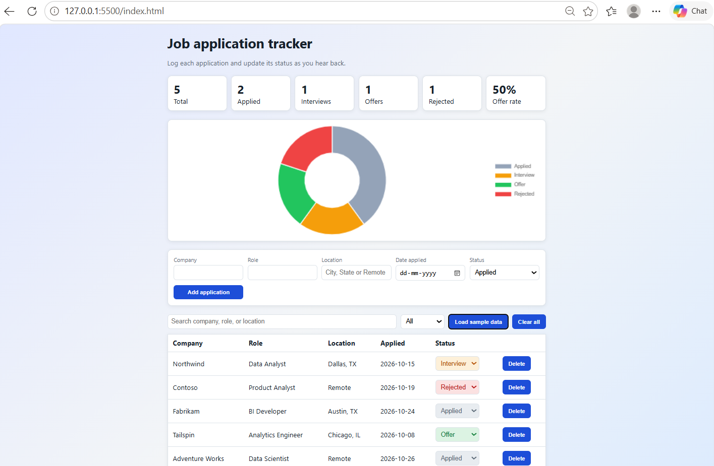

# Job-Tracker
Dashboard to track job applications and their status
# Job Application Tracker

A dashboard to track job applications and their status (Applied, Interview, Offer, Rejected), with live stats and a status chart.

**Live demo:** https://jelciyagodwinchikkala99.github.io/Job-Tracker/

## Features
- Add applications with company, role, location, date, and status
- Update status with a dropdown, and delete entries
- Summary cards: total, applied, interviews, offers, rejections, offer rate
- Doughnut chart of status breakdown (Chart.js)
- Search by company, role, or location, plus a status filter
- Data saved in the browser with localStorage
- Responsive layout
- "Load sample data" and "Clear all" buttons

## Tech stack
HTML, CSS, JavaScript (vanilla), Chart.js, Git and GitHub Pages

## What I learned
- Managing app state as an array of objects and re-rendering the UI from it
- Using array methods (filter, map, reduce) for search, filtering, and stats
- Persisting data with localStorage
- Integrating a third-party library (Chart.js) and handling its lifecycle
- Deploying a static site with GitHub Pages

## Run locally
1. Clone the repo
2. Open `index.html` in a browser (or use the VS Code Live Server extension)

## Future improvements
- Backend and database so data syncs across devices
- Export and import as CSV
- Follow-up reminders